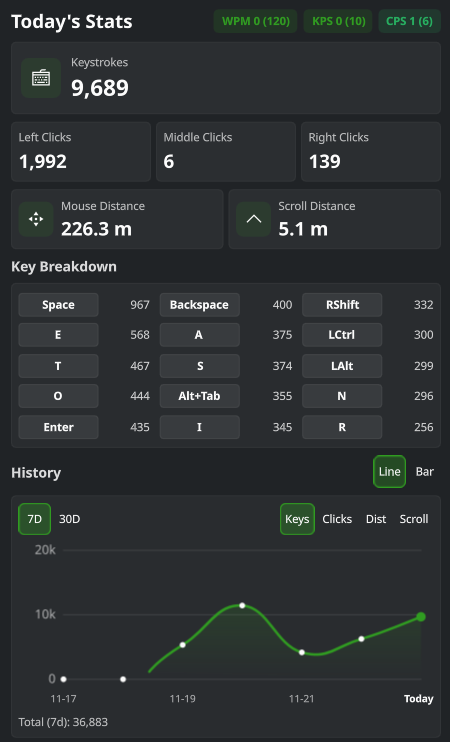
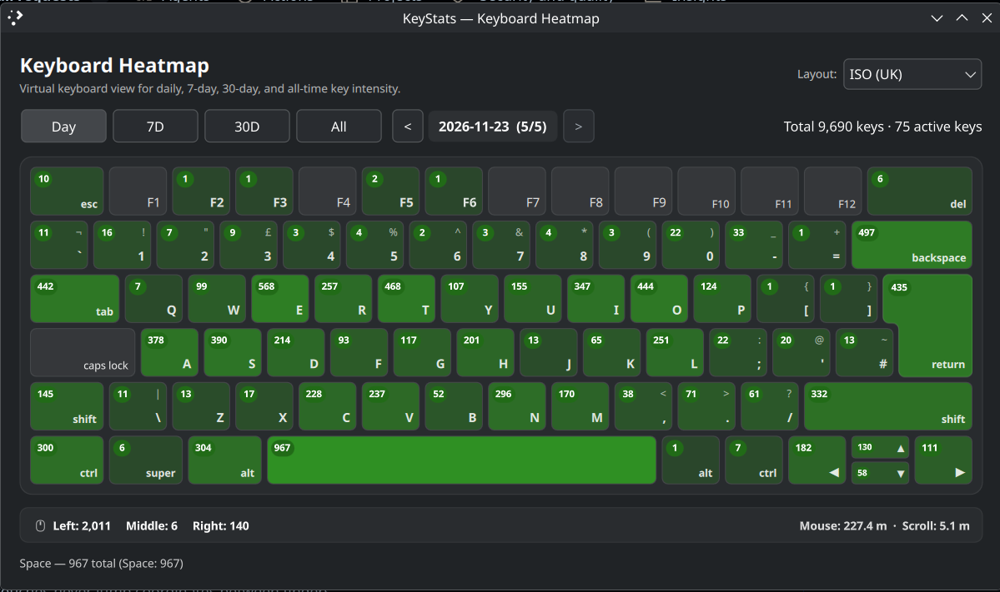

# KeyStats KDE Plasma 6 Widget

A native KDE Plasma 6 Plasmoid for `keystats-daemon` that displays live keyboard, mouse, and multi-touch touchpad statistics in your Plasma panel.

## Features
- **Adaptive Panel Indicator:** Automatically stacks keystrokes and mouse clicks vertically on thick panels (`>= 36px`) or displays them inline on thin panels. Configurable between **Keys & Clicks**, **Keys Only**, and **Icon Only**.
- **Live WPM, KPS & CPS Pills:** Real-time and peak words per minute (`KPS × 12`), keystrokes per second, and clicks per second in the popup header—featuring a 5-second burst hold buffer so recent typing speeds stay visible when opening the popup.
- **Today's Stats Dashboard:**
  - Full-width **Keystrokes** hero card.
  - 3-column click breakdown for **Left Clicks**, **Middle Clicks**, and **Right Clicks**.
  - 2-column distance cards for **Mouse Distance** and **Scroll Distance** with physical EDID DPI scaling (`Screen.pixelDensity`) supporting **Metric (`m / km`)**, **Imperial (`ft / mi`)**, and **Raw Pixels (`px`)**.
- **Top 15 Keys Today:** 3×5 grid displaying today's top 15 keys and modifier combos with full keycap badges.
- **Interactive History Chart:**
  - Switch between **7D** and **30D** ranges, **Line** and **Bar** chart styles, and **Keys / Clicks / Dist / Scroll** metric tabs.
  - Auto-scaling Y-axis labels, interactive hover crosshairs with daily tooltips, and a period **Total** summary.
- **Interactive Keyboard & Mouse Heatmap:**
  - Supports **ANSI US**, **ISO UK**, **ISO DE**, and **ISO FR** physical layouts (including an L-shaped ISO Return key) and follows your active KDE Plasma color scheme and accent color.
  - Filterable across **Day** (with date navigation), **7D**, **30D**, and **All** ranges alongside a **Mouse Buttons & Distance** summary bar and 3-second live auto-refresh.
  - Keyboard shortcuts: `1`–`4` (switch range), `←` / `→` (step dates in Day view), `Esc` (close).
- **Native Plasma Settings:** Right-click the panel indicator → **Configure KeyStats...** to customize panel indicator style, distance units, and the `keystatsctl` binary path.

### Main Widget


### Keyboard Heatmap


## Requirements
- **KDE Plasma 6** (`plasma-workspace`, `kirigami`)
- **`sqlite3` CLI** (used for read-only historical queries and heatmap data)
- **`keystats-daemon` & `keystatsctl`** installed and running

## Installation

1. Ensure `keystats-daemon` and `keystatsctl` are installed and running (from project root):
   ```bash
   cargo build --release
   sudo install -Dm755 target/release/keystats-daemon /usr/local/bin/keystats-daemon
   sudo install -Dm755 target/release/keystatsctl /usr/local/bin/keystatsctl
   systemctl --user enable --now keystats
   ```
2. Install the Plasma 6 widget from the repository root:
   ```bash
   make install-plasma
   ```
   *(Or manually copy `plasma-widget/io.github.0x5c0f.keystats` to `~/.local/share/plasma/plasmoids/`.)*
3. Right-click your Plasma panel → **Add or Manage Widgets...** → search for **KeyStats** and add it to your panel.
